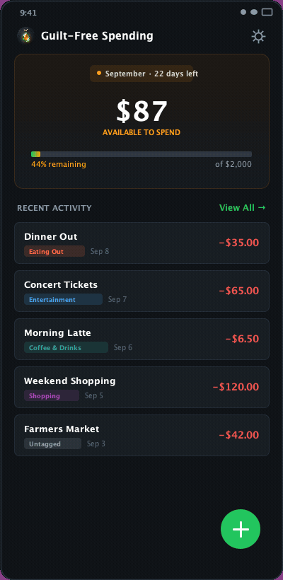
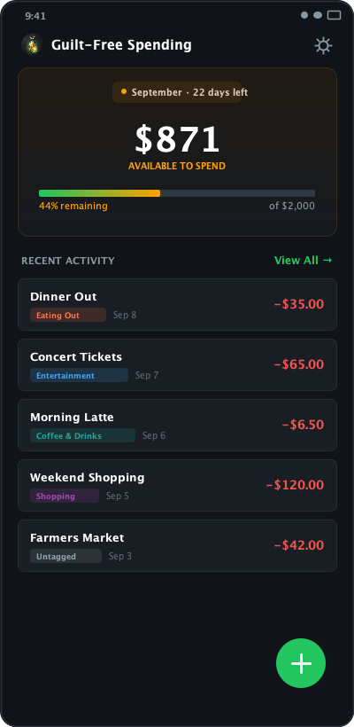
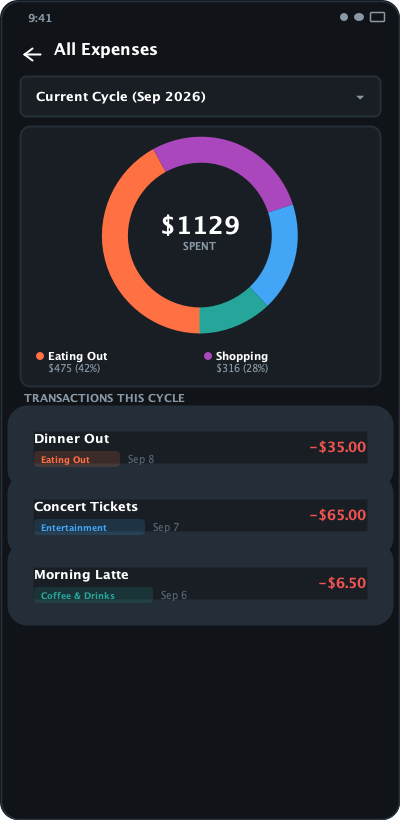

<p align="center">
  
</p>

<h1 align="center">gfs</h1>

<p align="center">
  <strong>Guilt-Free Spending Tracker for Android</strong><br>
  Once your fixed costs, savings, and investments are automated — this is the money you can spend completely guilt-free.
</p>

<p align="center">
  <a href="https://github.com/samuelkyl/gfs/releases/latest"></a>
  <a href="https://github.com/samuelkyl/gfs/actions/workflows/android-ci.yml"></a>
  <a href="LICENSE"></a>
</p>

<p align="center">
  
</p>

---

## ✨ Features

- **🎯 Available-to-Spend Dashboard**: Real-time guilt-free balance with color-coded pacing, daily allowance, and cycle countdown.
- **🔄 Smart Rollover & Caps**: Unspent budget carries over into the next cycle (up to a configurable cap, overflow banked as extra savings); deficits carry forward so you stay honest.
- **🍩 Spending Breakdown**: Interactive donut chart with customizable categories and color-coded tags.
- **📅 Historical Cycles**: Browse past billing cycles, review spending trends, or filter all-time activity.
- **💾 Offline & Private**: Zero network permissions, zero tracking. Cent-accurate offline accounting with JSON backup and restore.

---

## 📱 Screenshots

<p align="center">
  
  &nbsp;&nbsp;&nbsp;&nbsp;
  
</p>

---

## 📦 Download

Download the latest signed APK from [**GitHub Releases**](https://github.com/samuelkyl/gfs/releases/latest). Requires **Android 8.0+** (API 26+).

---

## 🛠️ Tech Stack

- **UI**: Jetpack Compose & Material 3 (Edge-to-Edge, Dark Mode, Dynamic Color, Predictive Back)
- **Architecture**: Clean Architecture & MVI/UDF with Kotlin Coroutines & StateFlow
- **DI**: Dagger Hilt
- **Persistence**: Room Database (SQLite) & DataStore Preferences
- **Build**: Gradle 9, AGP 9.5, Kotlin 2.4, targetSdk 37

---

## 💻 Development

```bash
# Run unit tests
./gradlew testDebugUnitTest

# Run lint checks
./gradlew lintDebug

# Build release APK
./gradlew assembleRelease
```

---

## 📄 License

Distributed under the [MIT License](LICENSE).
